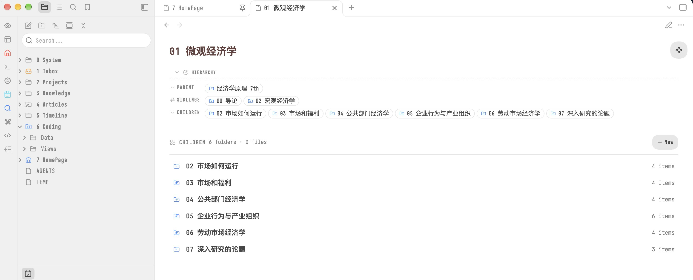

<div align="center">

<h1>Hierarchy Navigator</h1>

<p><strong>在每篇笔记顶部渲染「父级 / 兄弟 / 子级」导航块的 Obsidian 插件</strong></p>
<p>需要 Obsidian 1.13.0 或更高版本</p>

<p>
  <strong>简体中文</strong> |
  <a href="README.md">English</a>
</p>

[](https://github.com/butfool/obsidian-hierarchy-navigator/releases/latest)
[](https://obsidian.md/plugins?id=hierarchy-navigator)
[](https://obsidian.md)
[](LICENSE)

</div>

---

<p align="center">
  
</p>

## What is this

Hierarchy Navigator 在每篇笔记的顶部渲染一个导航块，说明这篇笔记在文件夹树中的位置：父级在哪里、旁边有哪些同级项、自己里面装着什么。打开任意一篇笔记，不切换到文件浏览器就能看到它的父级、兄弟与子项。

导航块在渲染时注入到笔记视图，阅读视图与 Live Preview 下表现一致。你的 `.md` 文件不会被改写；插件只在你明确要求新建笔记或文件夹时才写盘。

思路来自思源笔记的 [`hierarchyNavigate`](https://github.com/OpaqueGlass/syplugin-hierarchyNavigate)，并遵循 [AidenLx's Folder Note](https://github.com/aidenlx/alx-folder-note) 的语义实现。

### English description

Hierarchy Navigator renders a parent / siblings / children navigation block at the top of every Obsidian note. It works with Folder Note, uses Obsidian's view registry to filter openable files, and never rewrites note source files. The plugin also provides an optional children index and explicit create actions for empty Folder Notes.

## Features

- 阅读视图与 Live Preview 下渲染同一个顶部导航块；正文子项索引只在阅读视图显示
- 配合 Folder Note 工作，Folder Note 会以它所代表的文件夹参与导航
- 依据 Obsidian 自己的视图注册表过滤扩展名，只显示能被打开的文件
- 区块内文件夹排在文件前面，按自然顺序排列，`9` 排在 `10` 之前
- 文件夹与笔记使用统一尺寸的导航胶囊；Folder Note 通过蓝色图标区分
- 每个条目按文件类型着色区分：笔记、Canvas、Base、PDF、图片、音频、视频、代码
- Folder Note 正文为空时，在正文区渲染子项索引；没有子项时只显示轻量的「新建子项」入口
- 创建弹窗提供带图标的「普通笔记 / 文件夹笔记 / 文件夹」三段式选择器，默认选择文件夹笔记；切换类型保留名称，实时预览目录结构，弹窗高度保持固定并适配小屏幕
- 普通笔记创建后直接打开；文件夹笔记创建同名文件夹及入口笔记并打开入口；空文件夹创建后刷新列表
- 新建操作走 Obsidian 自身的 `createNewMarkdownFile`，不会覆盖已存在的路径
- 界面提供 English 与 简体中文，在设置中切换后立即生效，无需重载

## Install

插件已经上架社区插件市场。

### 社区插件市场（推荐）

1. 在 Obsidian 中打开 **Settings → Community plugins**，点击 **Browse**，搜索 `Hierarchy Navigator`。
2. 点击 **Install**，然后在 **Installed plugins** 中启用 **Hierarchy Navigator**。

也可以直接点击下面的链接安装：[obsidian://show-plugin?id=hierarchy-navigator](obsidian://show-plugin?id=hierarchy-navigator)

插件市场页面：<https://obsidian.md/plugins?id=hierarchy-navigator>

### 手动安装

1. 打开 [Releases](https://github.com/butfool/obsidian-hierarchy-navigator/releases/latest)，在同一版本的附件中下载 `main.js`、`manifest.json` 和 `styles.css` 三个文件。
2. 创建 `YOUR_VAULT/.obsidian/plugins/hierarchy-navigator/` 目录，将三个文件放进去。
3. 在 **Settings → Community plugins → Installed plugins** 中启用 **Hierarchy Navigator**。

社区插件安装器使用的就是这三个独立附件。普通用户无需安装 Node.js 或自行构建。

### BRAT 预览版

在 BRAT 的插件列表中添加仓库地址：

```
https://github.com/butfool/obsidian-hierarchy-navigator
```

## Settings

**Settings → Hierarchy Navigator** 中可配置：

| 配置项 | 可选值 | 默认值 |
|---|---|---|
| Language | English / 简体中文 | 简体中文 |
| Header label | 自由文本 | `Hierarchy` |
| Show parent folder | 开关 | 开启 |
| Show siblings | 开关 | 关闭 |
| Show folders | 开关 | 开启 |
| Show files | 开关 | 开启 |
| Section layout | Single line / Wrap | Single line |
| Max items per section | 数字（不小于 1） | 6 |
| Show a children index in the note body | 开关 | 开启 |
| Show a create button in the body index | 开关 | 开启 |

关闭新建按钮后，插件变为严格只读。在某篇笔记的 frontmatter 中加入 `hierarchy-nav: hide` 可以单独跳过该笔记。点击导航块顶部的标题栏可以折叠整个区块，这个折叠状态会在切换笔记后保留。

## Commands

在 **Settings → Hotkeys** 中为以下命令分配快捷键，命令名称跟随插件的界面语言。

| 命令 | 作用 |
|---|---|
| 在文件浏览器中定位父文件夹 | 在文件浏览器中选中父级文件夹 |
| 打开第一个子文件 | 打开当前 Folder Note 下按导航规则排序后的第一个条目 |

## Development

```bash
git clone https://github.com/butfool/obsidian-hierarchy-navigator.git
cd obsidian-hierarchy-navigator
npm install
npm run dev      # 监听 src/ 目录，每次改动重新构建 main.js
```

开发时把仓库放在 vault 的 `.obsidian/plugins/hierarchy-navigator/` 下，每次构建完成后重载 Obsidian 即可看到效果。

## Releasing

发布工作流位于 `.github/workflows/release.yml`。它只构建标签对应的已提交代码，使用锁文件安装依赖，校验标签与版本一致，运行完整检查，并为三个标准附件生成构建来源证明。

1. 将 `manifest.json`、`package.json` 和 `package-lock.json` 中的版本统一为新的 `x.y.z`，更新 `versions.json`，并同步 README 版本徽章。若提高 `minAppVersion`，需在 `versions.json` 中补充兼容的版本映射。
2. 完成验证并提交、推送本次发布的全部目标改动。不要从含未提交源码的工作区构建发布附件。
3. 创建与 manifest 版本完全相同的标签（不带 `v`），例如：

```bash
git tag -a 0.3.4 -m "0.3.4"
git push origin 0.3.4
```

4. 等待 **Actions → Release Obsidian plugin** 成功。它会创建草稿 Release，并上传 `main.js`、`manifest.json` 和 `styles.css`。
5. 核对附件和发布说明，然后选择 **Publish release**。草稿尚不能作为公开安装来源。

上面的 `0.3.4` 仅为下一版本示例，必须替换成 manifest 中的实际版本。新版本会由 Obsidian 社区目录自动审核。商店页面的说明文字来自本仓库的 `README.md`。

## License

[MIT](LICENSE) © 2026 butcool

## 友链

[Linux Do](https://linux.do)
